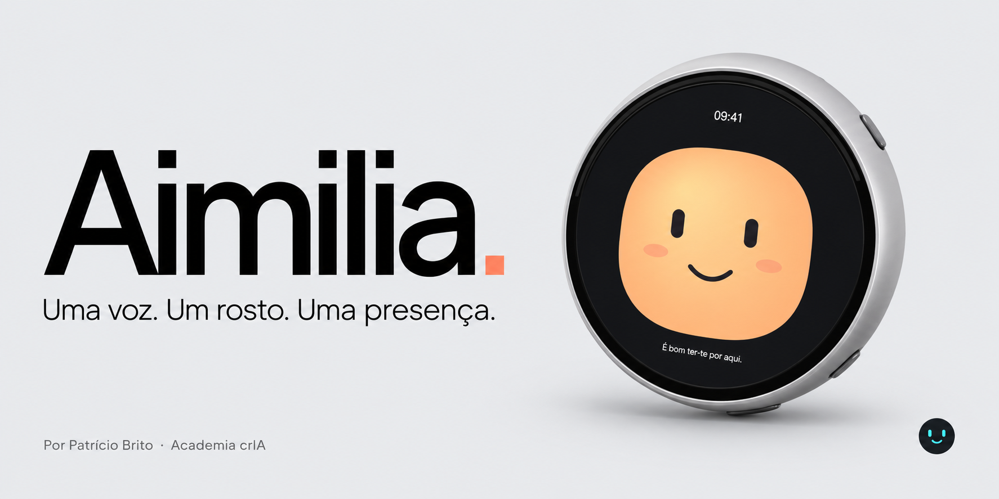

<p align="center"></p>

<h1 align="center">Aimilia · uma companheira digital para construir</h1>
<p align="center">Voz, expressões e personalidade num pequeno ecrã circular.<br>Um projeto maker de <strong>Patrício Brito</strong>, construído sobre o XiaoZhi.</p>
<p align="center"><a href="https://aimilia.vercel.app/">Website</a> · <a href="docs/03-instalacao.md">Construir passo a passo</a> · <a href="prompts/instalar-com-codex.md">Instalar com o Codex</a> · <a href="https://www.academiacria.pt/">Academia crIA</a></p>
<p align="center">   </p>

## O que é a Aimilia?

A Aimilia é uma pequena companheira de voz: ouve uma pergunta, conversa através do serviço XiaoZhi e dá expressão à resposta no ecrã da Waveshare. Pode ajudar a explorar ideias, explicar conceitos ou conversar sobre o quotidiano. O projeto acrescenta identidade visual, expressões, boca animada, reações ao toque e ao movimento, menus e ferramentas opcionais.

O ESP32 apresenta a interface e trata a entrada e saída de áudio. **O modelo de linguagem não corre na placa:** a conversa requer Wi-Fi e serviços externos. A voz portuguesa usada no protótipo é **português do Brasil (pt-BR)**; escolher textos pt-PT não muda o sotaque do sintetizador.

Este repositório disponibiliza **código-fonte de personalização, preparação reproduzível e documentação**. Não contém a memória, as contas, os emails, as redes Wi-Fi ou as credenciais do autor. Também não distribui um dump da placa, firmware pré-configurado ou um instalador de um clique.

## O que podes construir

| Na placa | No serviço de conversa | Extensões opcionais nas tuas contas |
| --- | --- | --- |
| 18 geometrias de expressão; olhos, sobrancelhas e detalhes | Reconhecimento da fala, modelo e síntese de voz XiaoZhi | Manchetes RTP e hora de Portugal |
| Boca que acompanha a reprodução de voz | Personalidade configurável e memória do serviço | Preferências e agenda persistentes no Cloudflare |
| Clássica original, Clássica escura e Formas | Respostas com contexto e emoções enviadas pelo servidor | Gmail, **apenas leitura**, mediante OAuth do titular |
| Toque, movimento, volume, luminosidade, Wi-Fi e bateria | Funciona sem o Mac ligado depois de configurada | Cada maker cria as próprias contas e segredos |

**Limites claros:** a agenda guarda e consulta entradas; não toca alarmes automaticamente. Guardar uma rádio favorita não a reproduz. O projeto não é um dispositivo médico, sistema de vigilância ou serviço de emergência. A memória e as respostas da IA podem falhar. [Capacidades, limites e estado de validação →](docs/01-visao-geral.md)

## Começa por aqui

1. **Confirma a placa:** Waveshare **ESP32-S3-Touch-AMOLED-1.75C**, e não outra variante. [Hardware e compra em Portugal →](docs/02-hardware.md)
2. **Lê o plano de instalação e faz uma cópia de segurança da tua placa.** Uma placa com Muse/dual boot não recebe a receita standalone. [Guia passo a passo →](docs/03-instalacao.md)
3. **Prepara e compila** o XiaoZhi na revisão fixa deste repositório, com as personalizações Aimilia. Os scripts não gravam a placa.
4. **Configura a tua rede e o teu agente XiaoZhi.** [Primeira conversa e personalidade →](docs/04-configurar-xiaozhi.md)
5. **Testa voz, ecrã, gestos e bateria.** [Checklist e diagnóstico →](docs/07-testes-e-diagnostico.md)
6. Se quiseres, acrescenta as tuas próprias **notícias, preferências, agenda e Gmail**. [Guia MCP →](docs/06-mcp-cloudflare.md)

Preferes ajuda assistida? Abre este repositório no Codex e usa o [prompt completo de instalação](prompts/instalar-com-codex.md). O prompt exige inspeção, backup e um plano de gravação específico; não manda apagar a flash às cegas.

## Hardware de referência

**Waveshare ESP32-S3-Touch-AMOLED-1.75C** · ESP32-S3R8 até 240 MHz · 8 MB PSRAM · 32 MB flash · AMOLED circular 1,75″, 466 × 466 · toque capacitivo · dois microfones · altifalante · IMU de seis eixos · USB-C · bateria e gestão de energia.

**[Ver o dispositivo na Mauser, em Portugal ↗](https://mauser.pt/095-9590/waveshare-33691-kit-desenvolvimento-esp32-s3-com-ecra-amoled-1-75)** — referência 095-9590 / Waveshare 33691. Confirma a variante 1.75C, os componentes incluídos, preço e disponibilidade na loja. Não vendemos o equipamento nem garantimos stock. [Documentação oficial Waveshare](https://docs.waveshare.com/ESP32-S3-Touch-AMOLED-1.75C).

## Estrutura do projeto

```text
firmware/manifest.json       Revisão base e hashes dos ficheiros públicos
firmware/overlay/            Personalizações de C/C++ e testes sobre XiaoZhi
firmware/profiles/           Perfil standalone 1.75C, sem redes ou credenciais
scripts/prepare.py          Cria work/xiaozhi isolado; verifica a revisão e os hashes
scripts/build.py            Compila; nunca grava a placa
integrations/cloudflare-mcp/ Ponte opcional, fonte e testes sem credenciais
advanced/dualboot/           Fontes de referência para o arranque duplo existente
prompts/                    Instruções para Codex e personalidade do agente
assets/                     Capa ilustrativa e sinais sonoros originais
```

**Base fixada:** [78/xiaozhi-esp32 @ cdc74a0](https://github.com/78/xiaozhi-esp32/tree/cdc74a0c1467ea517b37b44a8d56d517c715f6c8). ESP-IDF de referência: **6.0.1**. O caminho de build usa o script canónico do upstream; não segue automaticamente a última `main`.

> O protótipo do autor foi testado fisicamente em dual boot. O perfil público standalone é compilado e verificado separadamente; não foi gravado na placa do autor nesta publicação. Consulta o [registo de validação](docs/08-validacao.md). Não confundir compilação com validação física de uma instalação nova.

## Documentação

| Guia | Conteúdo |
| --- | --- |
| [Visão geral](docs/01-visao-geral.md) | Arquitetura, funcionalidades e limitações |
| [Hardware](docs/02-hardware.md) | Placa exata, ficha técnica e compra |
| [Instalação](docs/03-instalacao.md) | Ambiente, backup, compilação e gravação consciente |
| [XiaoZhi](docs/04-configurar-xiaozhi.md) | Rede, ativação, voz, memória e personalidade |
| [Interface](docs/05-interface-e-expressoes.md) | Skins, 18 expressões, gestos e bateria |
| [MCP / Cloudflare](docs/06-mcp-cloudflare.md) | Notícias, agenda, preferências e Gmail opcional |
| [Diagnóstico](docs/07-testes-e-diagnostico.md) | Checklist, áudio, hotspot e recuperação |
| [Validação](docs/08-validacao.md) | O que foi testado e o que falta validar na placa |
| [Dual boot avançado](advanced/dualboot/README.md) | Diferenças da instalação com Muse; sem dumps privados |
| [Privacidade](docs/09-privacidade.md) | Fluxo de dados, contas e revogação |
| [Créditos](CREDITS.md) | Autor, comunidade e componentes de terceiros |

## Contribuir

Encontraste um problema ou queres melhorar a Aimilia? Consulta [CONTRIBUTING.md](CONTRIBUTING.md), abre uma issue com a variante da placa, versão do SDK e passos para reproduzir, ou propõe uma alteração focada. Nunca publiques credenciais, dumps de flash, históricos de conversas ou emails. [Reportar uma vulnerabilidade →](SECURITY.md)

## Autor e créditos

**Conceito, direção criativa, personalização e integração: Patrício Brito.**

**[Academia crIA — www.academiacria.pt](https://www.academiacria.pt/)** · um espaço para explorar criatividade e inteligência artificial.

Construído com assistência de ferramentas de IA, incluindo Codex, sobre trabalho de comunidades open source. A base de firmware é o **XiaoZhi**, o hardware é **Waveshare** e as adaptações Kubi preservam a licença do respetivo autor. Não reivindicamos a autoria desses projetos, nem afiliação às marcas. [Atribuições e licenças completas](CREDITS.md).

Código e documentação deste projeto: [MIT](LICENSE), com avisos de terceiros preservados em [licenses/](licenses/). Capa criada com assistência de IA a partir da identidade do website; é uma ilustração, não uma fotografia nem um CAD oficial.
