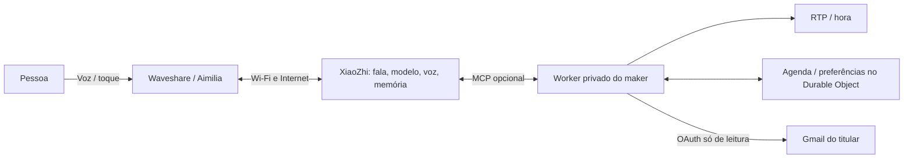

# Visão geral e arquitetura

[← Início](../README.md)

A Aimilia combina um pequeno dispositivo com serviços online. A presença visual é local; a inteligência conversacional depende do modelo e do contexto do XiaoZhi. Não existe uma medida de «QI» que descreva este produto.

## Camadas

- **Firmware:** LVGL, desenho de olhos e boca, skins, toque, movimento, áudio, rede e leitura da bateria. O overlay copia apenas os ficheiros necessários sobre a revisão fixa do XiaoZhi.
- **Agente:** personalidade, modelo, voz e memória são configurados no serviço XiaoZhi. Disponibilidade e latência desse serviço não são controladas pelo firmware.
- **Ferramentas:** o código opcional de Cloudflare abre uma ligação WebSocket de saída ao endpoint MCP do agente. Não é um servidor MCP HTTP genérico a que se possa ligar qualquer cliente. Há persistência de preferências e agenda, e leitura opcional do Gmail.
- **Website:** demonstra o projeto. Os modelos 3D, skins e áudio da apresentação são ilustrações web; não controlam a placa.

## O que significam «expressão» e «personalidade»

O servidor pode enviar uma emoção. O firmware traduz-a para uma pose visual e acrescenta piscar, olhar e detalhes. Há regras locais limitadas de contexto, gestos e transições; não é deteção clínica do estado emocional de quem fala. O prompt orienta o estilo, mas não cria ferramentas, uma memória perfeita ou capacidades inexistentes.

## Funcionalidades e dependências

| Função | Precisa de Internet? | Observação |
| --- | --- | --- |
| Skins, menu, volume, brilho, leitura da bateria | Não | Percentagem depende do PMIC/bateria |
| Expressões e reação visual a toque/movimento | Não | Só reage nas condições permitidas pelo estado da conversa |
| Conversa e voz do agente | Sim | XiaoZhi; conta e configuração próprias |
| Meteorologia IPMA | Sim | Ferramenta no firmware; não pesquisa web geral |
| Notícias RTP e hora | Sim | Ponte MCP opcional |
| Agenda e preferências | Sim | Guardadas no Cloudflare; consulta a pedido |
| Gmail | Sim | Opcional; OAuth e leitura apenas |
| Alarme autónomo de medicação | — | **Não implementado** |
| Spotify, chamadas aos filhos, rádio universal | — | **Não implementados neste pacote** |

## O que esta publicação não inclui

Dumps privados, NVS, chaves de assinatura, configurações de rede, memória pessoal, dados de agenda, emails ou credenciais de serviços. Não é distribuída a app Muse. O dual boot tem fontes de referência, mas não um instalador universal. Os antigos excertos de voz local gerados por vozes de sistema foram substituídos, na edição pública, por dois sinais não vocais originais. A conversa continua a usar a voz configurada no XiaoZhi.

## Utilização responsável

É um projeto experimental de companhia e aprendizagem para makers. Ainda não foi validado como sistema autónomo de apoio a pessoas vulneráveis. Não substitui familiares, profissionais de saúde, emergências ou lembretes fiáveis de medicação. Não existem garantias de resposta contínua, autonomia medida ou latência fixa.
